# pytikz example gallery

Generated by `python examples/build_all.py`. Each image links to its PDF; the `.tex` files are the generated LaTeX.

## Basics

### hello

[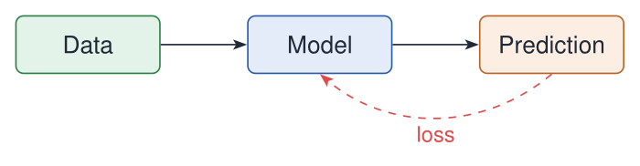](hello.pdf)

Source: [`basics/hello.py`](../basics/hello.py) · LaTeX: [`hello.tex`](hello.tex)

### themes_modern

[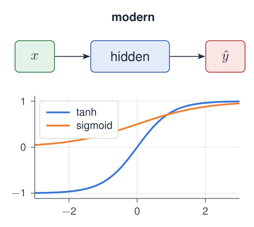](themes_modern.pdf)

Source: [`basics/themes.py`](../basics/themes.py) · LaTeX: [`themes_modern.tex`](themes_modern.tex)

### themes_paper

[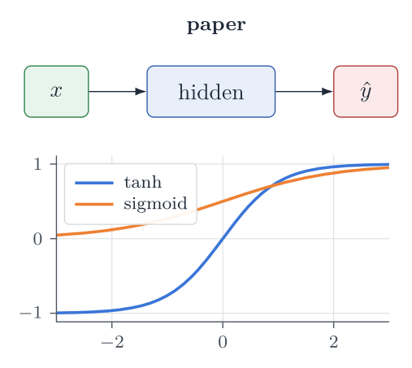](themes_paper.pdf)

Source: [`basics/themes.py`](../basics/themes.py) · LaTeX: [`themes_paper.tex`](themes_paper.tex)

### themes_dark

[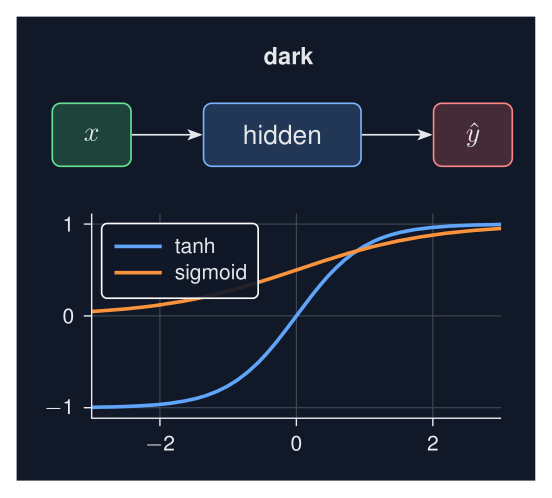](themes_dark.pdf)

Source: [`basics/themes.py`](../basics/themes.py) · LaTeX: [`themes_dark.tex`](themes_dark.tex)

### themes_mono

[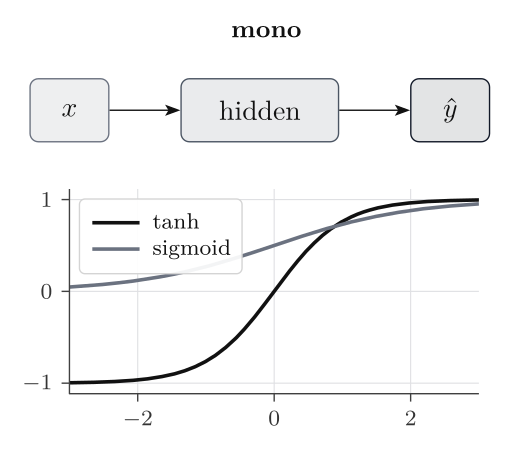](themes_mono.pdf)

Source: [`basics/themes.py`](../basics/themes.py) · LaTeX: [`themes_mono.tex`](themes_mono.tex)

### tour

[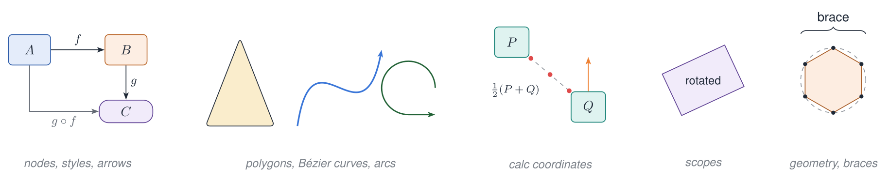](tour.pdf)

Source: [`basics/tour.py`](../basics/tour.py) · LaTeX: [`tour.tex`](tour.tex)

## Machine learning

### activations

[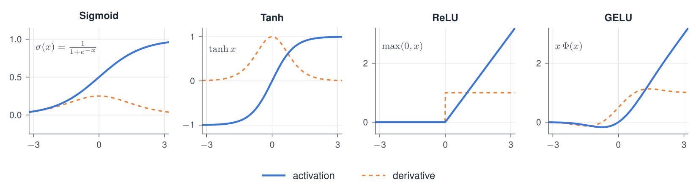](activations.pdf)

Source: [`ml/activations.py`](../ml/activations.py) · LaTeX: [`activations.tex`](activations.tex)

### attention

[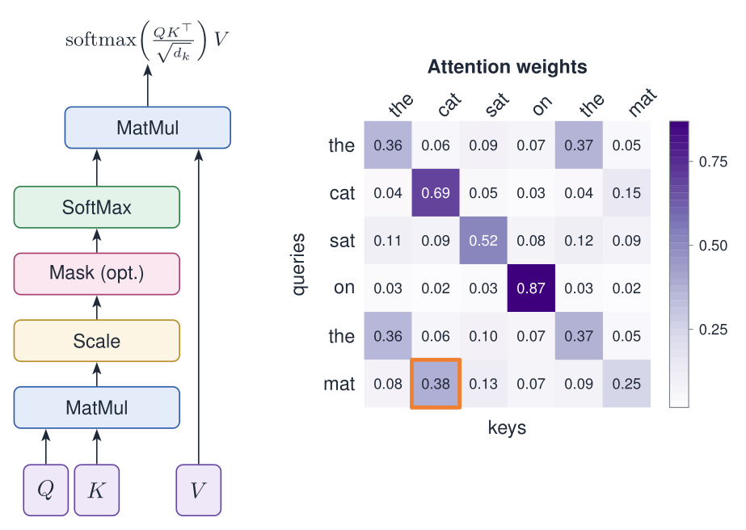](attention.pdf)

Source: [`ml/attention.py`](../ml/attention.py) · LaTeX: [`attention.tex`](attention.tex)

### backprop

[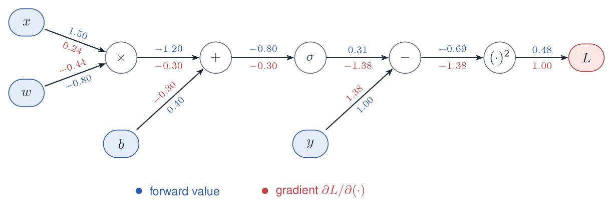](backprop.pdf)

Source: [`ml/backprop.py`](../ml/backprop.py) · LaTeX: [`backprop.tex`](backprop.tex)

### cnn

[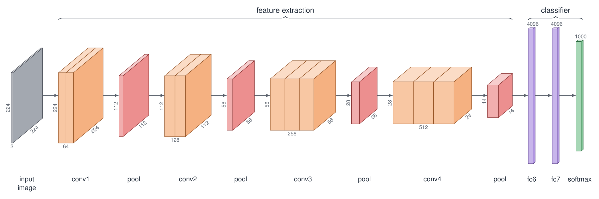](cnn.pdf)

Source: [`ml/cnn.py`](../ml/cnn.py) · LaTeX: [`cnn.tex`](cnn.tex)

### confusion_matrix

[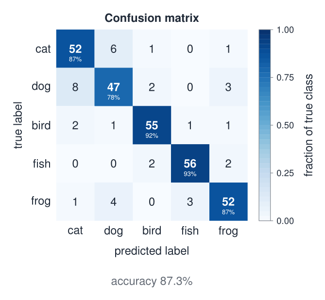](confusion_matrix.pdf)

Source: [`ml/confusion_matrix.py`](../ml/confusion_matrix.py) · LaTeX: [`confusion_matrix.tex`](confusion_matrix.tex)

### convolution

[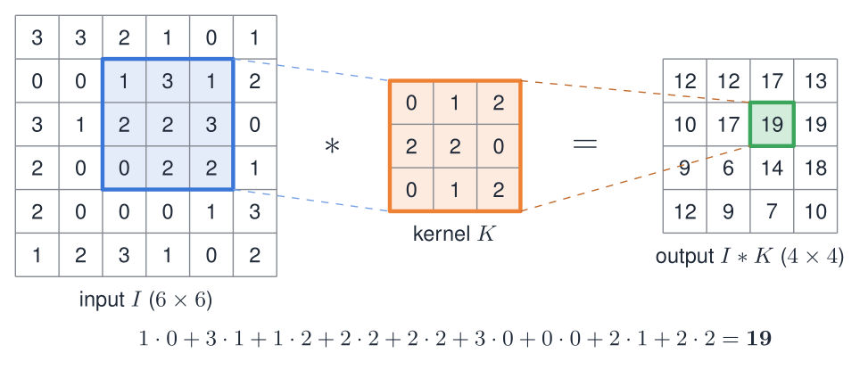](convolution.pdf)

Source: [`ml/convolution.py`](../ml/convolution.py) · LaTeX: [`convolution.tex`](convolution.tex)

### decision_tree

[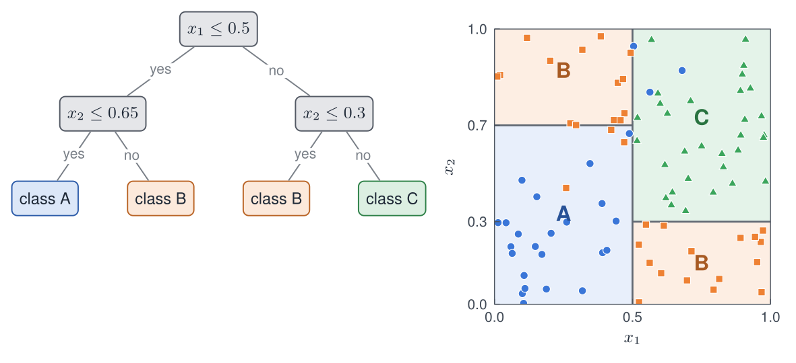](decision_tree.pdf)

Source: [`ml/decision_tree.py`](../ml/decision_tree.py) · LaTeX: [`decision_tree.tex`](decision_tree.tex)

### gan

[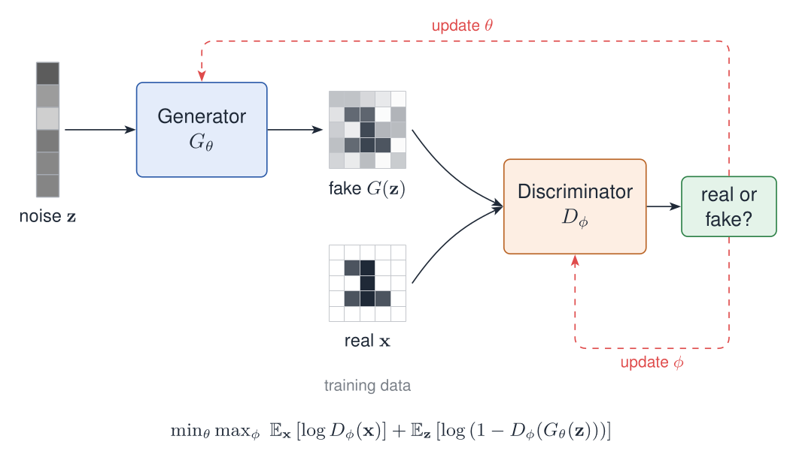](gan.pdf)

Source: [`ml/gan.py`](../ml/gan.py) · LaTeX: [`gan.tex`](gan.tex)

### gradient_descent

[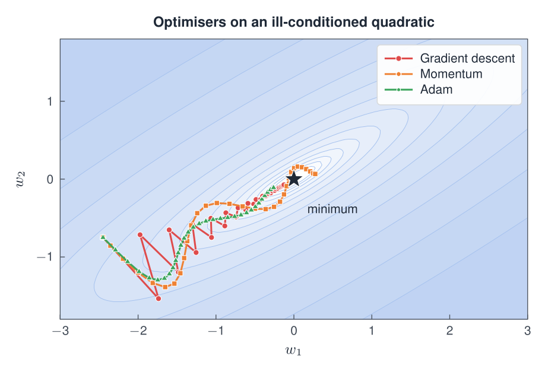](gradient_descent.pdf)

Source: [`ml/gradient_descent.py`](../ml/gradient_descent.py) · LaTeX: [`gradient_descent.tex`](gradient_descent.tex)

### kmeans

[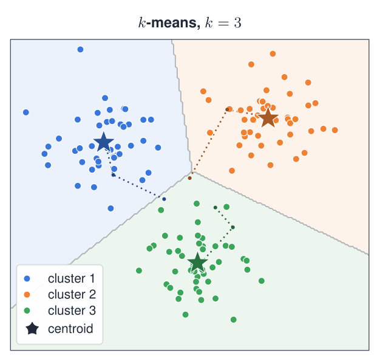](kmeans.pdf)

Source: [`ml/kmeans.py`](../ml/kmeans.py) · LaTeX: [`kmeans.tex`](kmeans.tex)

### learning_curves

[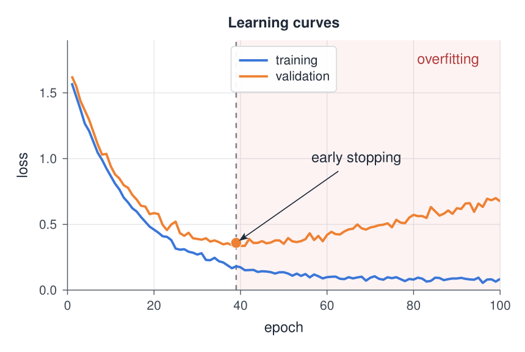](learning_curves.pdf)

Source: [`ml/learning_curves.py`](../ml/learning_curves.py) · LaTeX: [`learning_curves.tex`](learning_curves.tex)

### loss_landscape

[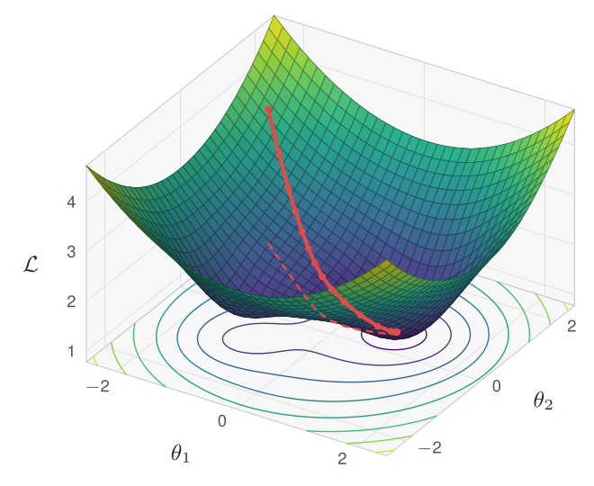](loss_landscape.pdf)

Source: [`ml/loss_landscape.py`](../ml/loss_landscape.py) · LaTeX: [`loss_landscape.tex`](loss_landscape.tex)

### mlp

[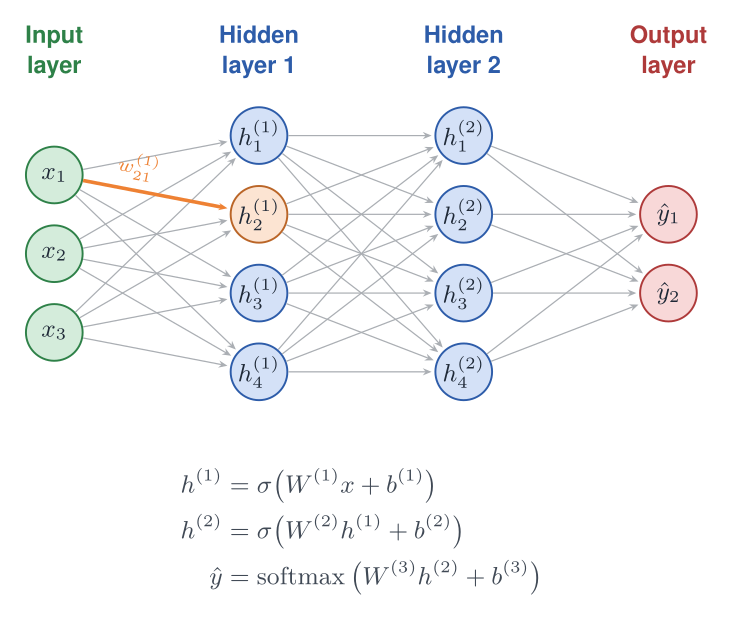](mlp.pdf)

Source: [`ml/mlp.py`](../ml/mlp.py) · LaTeX: [`mlp.tex`](mlp.tex)

### overfitting

[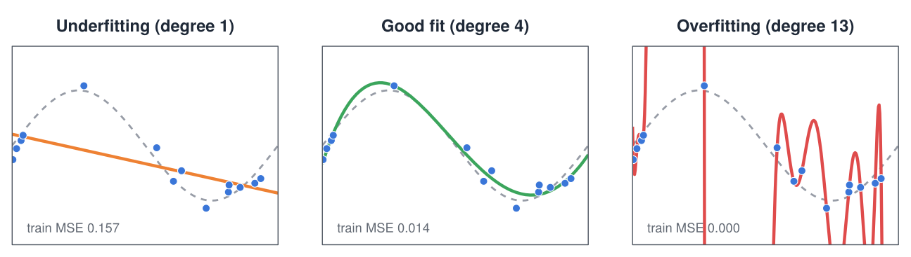](overfitting.pdf)

Source: [`ml/overfitting.py`](../ml/overfitting.py) · LaTeX: [`overfitting.tex`](overfitting.tex)

### pca

[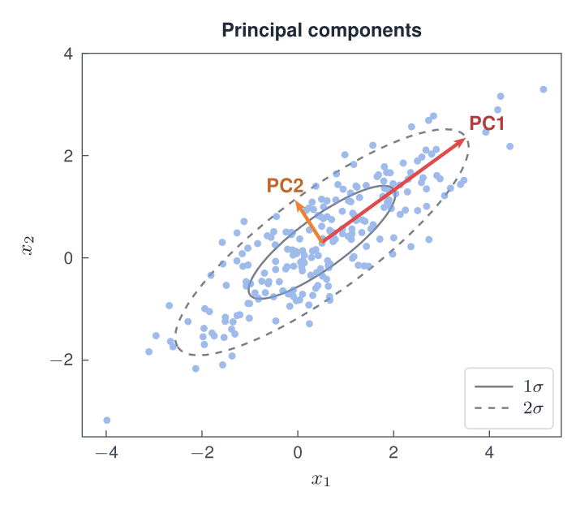](pca.pdf)

Source: [`ml/pca.py`](../ml/pca.py) · LaTeX: [`pca.tex`](pca.tex)

### positional_encoding

[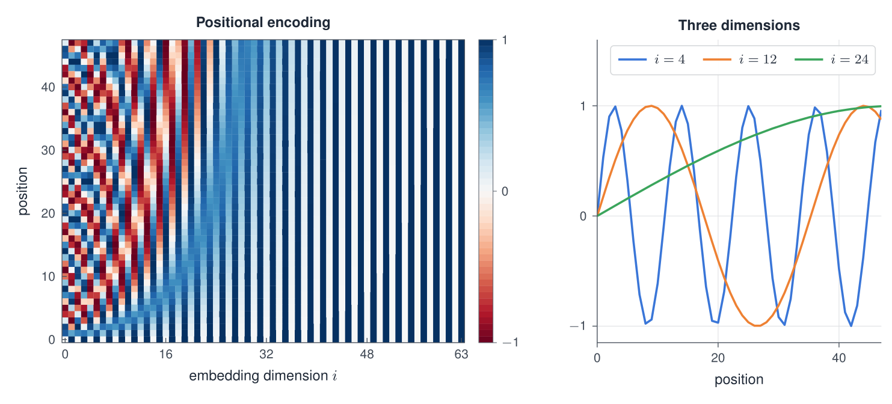](positional_encoding.pdf)

Source: [`ml/positional_encoding.py`](../ml/positional_encoding.py) · LaTeX: [`positional_encoding.tex`](positional_encoding.tex)

### resnet_block

[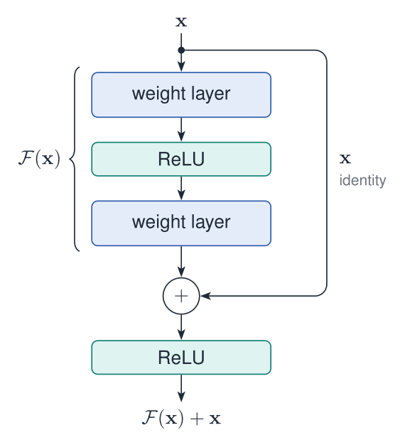](resnet_block.pdf)

Source: [`ml/resnet_block.py`](../ml/resnet_block.py) · LaTeX: [`resnet_block.tex`](resnet_block.tex)

### rnn

[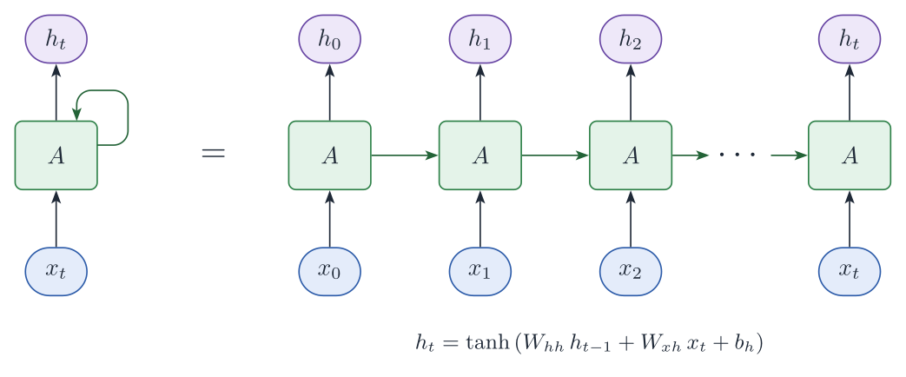](rnn.pdf)

Source: [`ml/rnn.py`](../ml/rnn.py) · LaTeX: [`rnn.tex`](rnn.tex)

### svm

[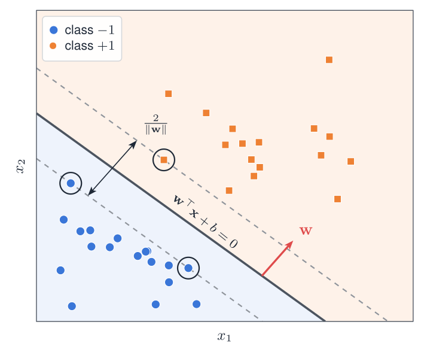](svm.pdf)

Source: [`ml/svm.py`](../ml/svm.py) · LaTeX: [`svm.tex`](svm.tex)

### transformer

[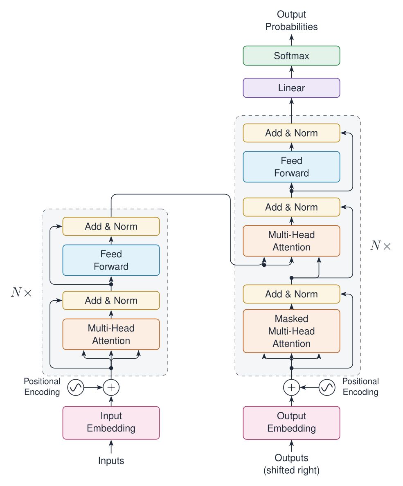](transformer.pdf)

Source: [`ml/transformer.py`](../ml/transformer.py) · LaTeX: [`transformer.tex`](transformer.tex)

### vae

[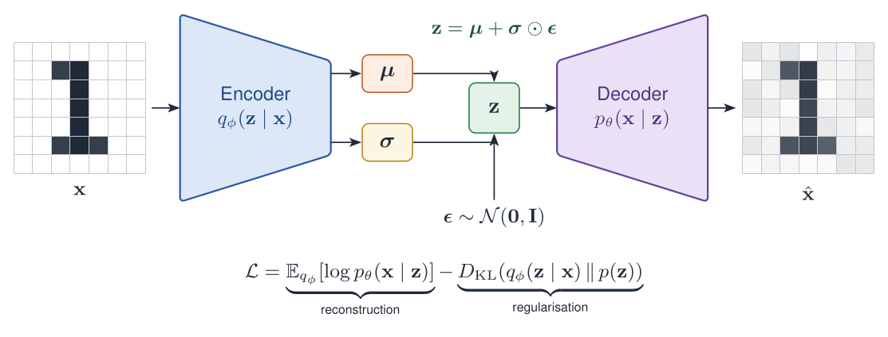](vae.pdf)

Source: [`ml/vae.py`](../ml/vae.py) · LaTeX: [`vae.tex`](vae.tex)

## Mathematics

### automaton

[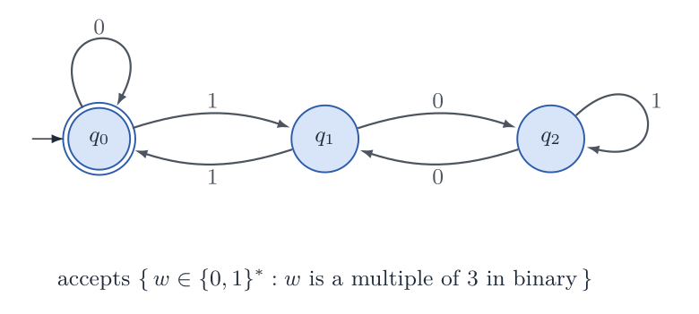](automaton.pdf)

Source: [`math/automaton.py`](../math/automaton.py) · LaTeX: [`automaton.tex`](automaton.tex)

### commutative_diagrams

[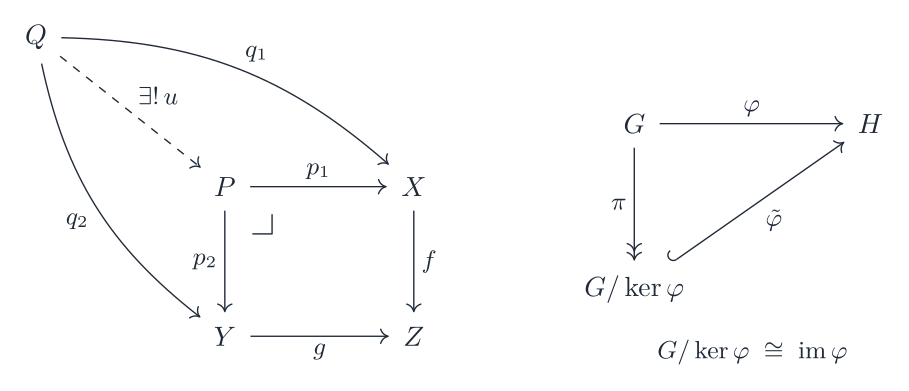](commutative_diagrams.pdf)

Source: [`math/commutative_diagrams.py`](../math/commutative_diagrams.py) · LaTeX: [`commutative_diagrams.tex`](commutative_diagrams.tex)

### derivative

[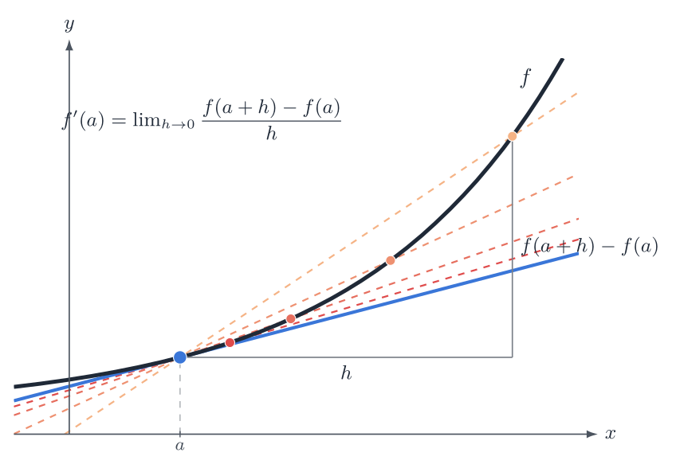](derivative.pdf)

Source: [`math/derivative.py`](../math/derivative.py) · LaTeX: [`derivative.tex`](derivative.tex)

### fourier_series

[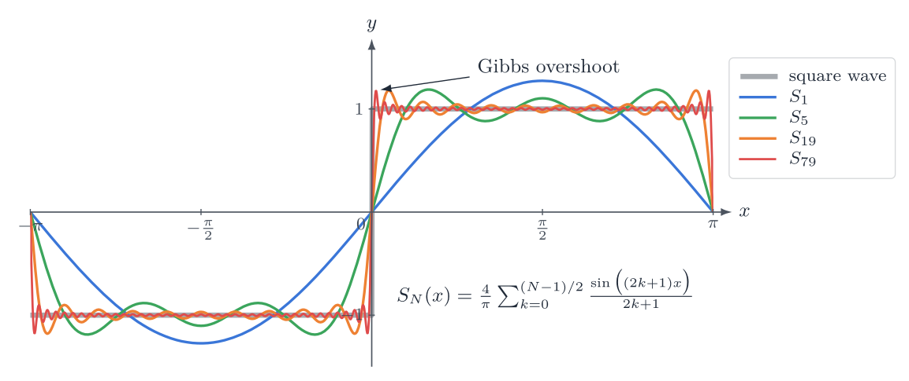](fourier_series.pdf)

Source: [`math/fourier_series.py`](../math/fourier_series.py) · LaTeX: [`fourier_series.tex`](fourier_series.tex)

### linear_map

[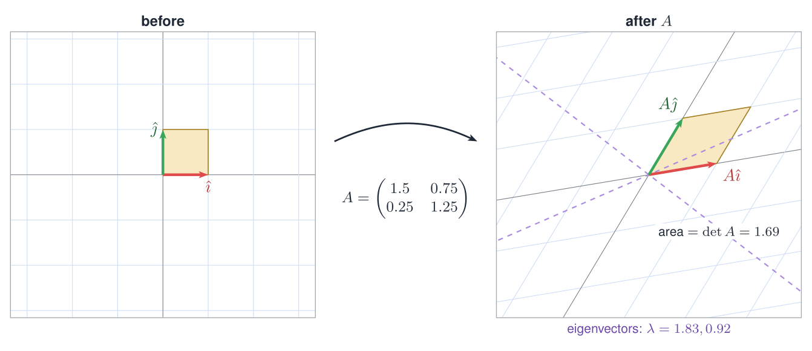](linear_map.pdf)

Source: [`math/linear_map.py`](../math/linear_map.py) · LaTeX: [`linear_map.tex`](linear_map.tex)

### matrix_product

[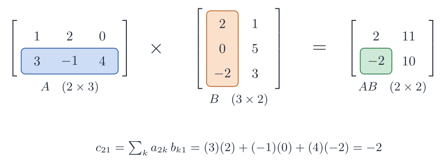](matrix_product.pdf)

Source: [`math/matrix_product.py`](../math/matrix_product.py) · LaTeX: [`matrix_product.tex`](matrix_product.tex)

### normal_distribution

[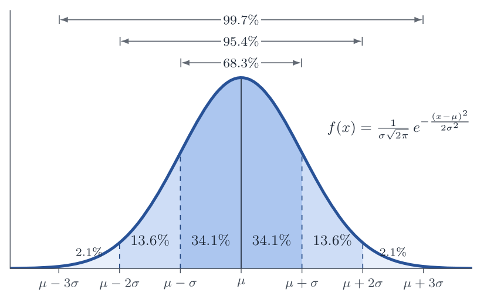](normal_distribution.pdf)

Source: [`math/normal_distribution.py`](../math/normal_distribution.py) · LaTeX: [`normal_distribution.tex`](normal_distribution.tex)

### phase_portrait

[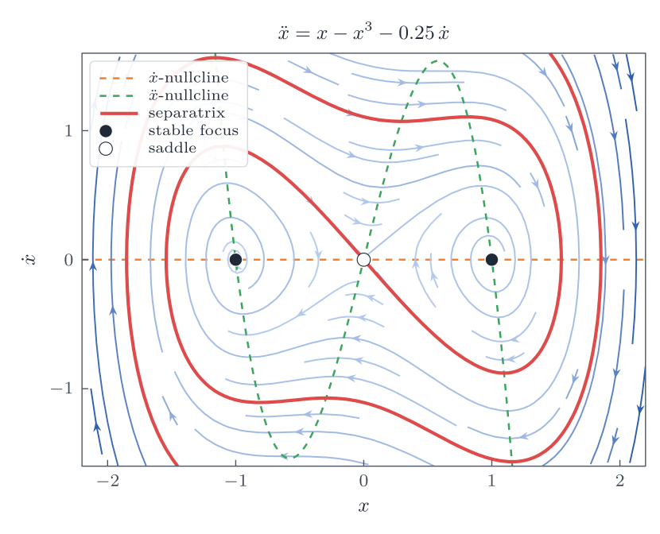](phase_portrait.pdf)

Source: [`math/phase_portrait.py`](../math/phase_portrait.py) · LaTeX: [`phase_portrait.tex`](phase_portrait.tex)

### pythagoras

[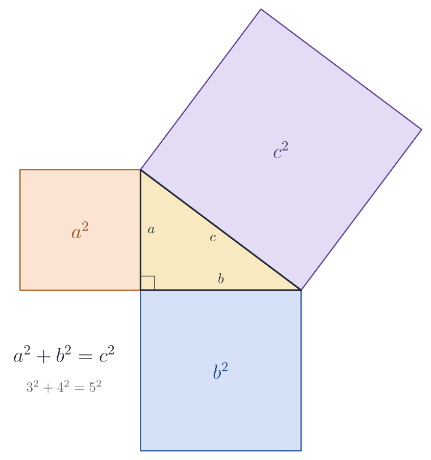](pythagoras.pdf)

Source: [`math/pythagoras.py`](../math/pythagoras.py) · LaTeX: [`pythagoras.tex`](pythagoras.tex)

### riemann_sum

[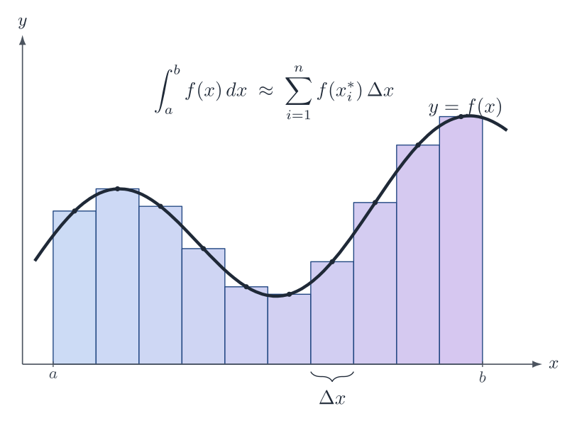](riemann_sum.pdf)

Source: [`math/riemann_sum.py`](../math/riemann_sum.py) · LaTeX: [`riemann_sum.tex`](riemann_sum.tex)

### roots_of_unity

[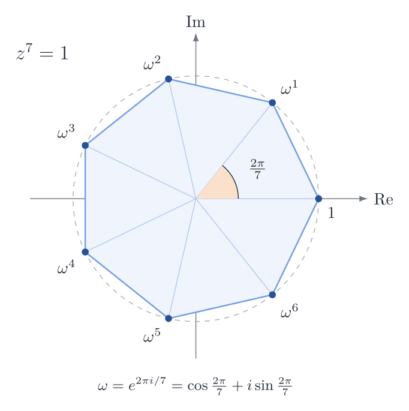](roots_of_unity.pdf)

Source: [`math/roots_of_unity.py`](../math/roots_of_unity.py) · LaTeX: [`roots_of_unity.tex`](roots_of_unity.tex)

### shortest_path

[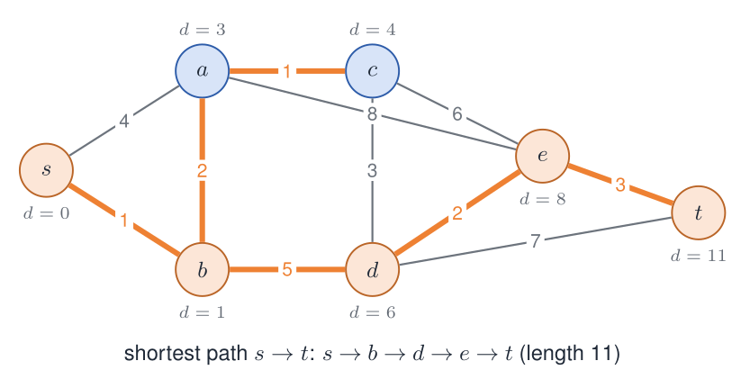](shortest_path.pdf)

Source: [`math/shortest_path.py`](../math/shortest_path.py) · LaTeX: [`shortest_path.tex`](shortest_path.tex)

### surfaces

[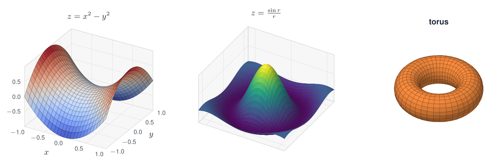](surfaces.pdf)

Source: [`math/surfaces.py`](../math/surfaces.py) · LaTeX: [`surfaces.tex`](surfaces.tex)

### taylor_series

[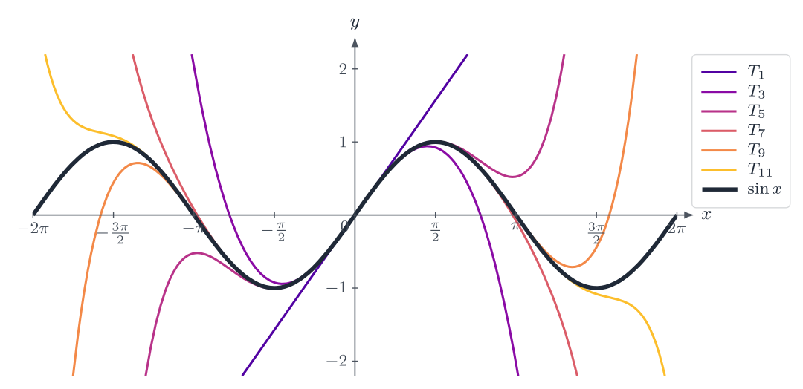](taylor_series.pdf)

Source: [`math/taylor_series.py`](../math/taylor_series.py) · LaTeX: [`taylor_series.tex`](taylor_series.tex)

### triangle_centers

[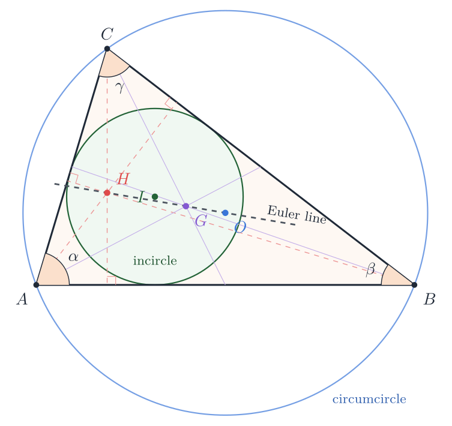](triangle_centers.pdf)

Source: [`math/triangle_centers.py`](../math/triangle_centers.py) · LaTeX: [`triangle_centers.tex`](triangle_centers.tex)

### unit_circle

[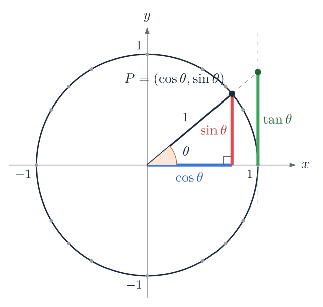](unit_circle.pdf)

Source: [`math/unit_circle.py`](../math/unit_circle.py) · LaTeX: [`unit_circle.tex`](unit_circle.tex)

### venn

[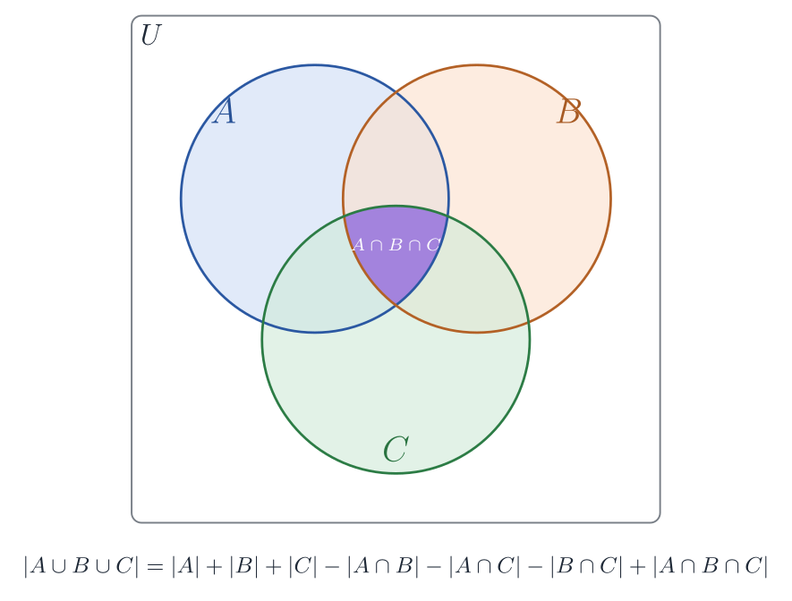](venn.pdf)

Source: [`math/venn.py`](../math/venn.py) · LaTeX: [`venn.tex`](venn.tex)
